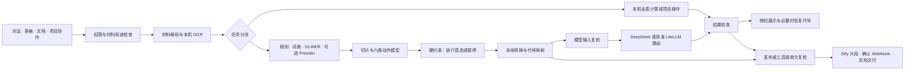

# 隐盾 2.0 融合版：项目目标、系统架构、创新与现状

## 一、项目目标

隐盾面向高校活动管理、学生组织与小组协作，把日常材料处理、隐私决策和结果交付接入同一个本机工作台。用户可以拿同一份表格做统计、起草通知或整理分工；系统根据任务、使用者身份、材料用途和接收方权限，决定在本机完成什么、哪些信息可以交给外部服务、哪些结果可以显示或交付。

- **保护原材料。** 原件解析、全表运算、身份映射和敏感原值处理优先在本机完成。
- **保留任务可用性。** 对统计保留筛选和计数口径；对生成任务保留必要事实与人物关系。风险或授权不明时暂停并说明原因。
- **让交付可核对。** 外部模型输入、本地授权展示、工具或外发各自检查，操作人员能看到当前交付对象和内容。
- **兼容实际部署。** 识别、生成代理、知识库和外部检查支持按需启用，默认安装无需开通第三方安全服务。

## 二、系统架构

图中只画成功路径。权限不足、材料失效、检查失败或依赖不可用时，相应路径暂停。B1、B2、B3 分别检查各自的载荷和接收方。可选 NeMo 执行本地短语策略；可选 Lakera 只在受控外发检查中处理获准的内容，授权恢复后的本机展示不会送给它。

| 层 | 当前实现与职责 |
| --- | --- |
| 应用入口 | FastAPI、原生网页和 Windows 启动器。首页提供对话、表格、接收方版本、项目协作和识别诊断。 |
| 材料与权限 | 解析表格、文档、PDF；可选本机 OCR 后保留逐页核对。检查身份、任务、接收方、材料用途、版本及有效期。 |
| 本机业务执行 | 支持的表格问题走全表筛选、分组、关联和去重。项目协作支持分配核验、供应商凭证、签到及封存验收。 |
| 识别 | 正则与适用的格式校验识别格式类实体，词典补充领域信息，GLiNER v3 补充人名、机构、地点、宿舍、敏感属性；Presidio 可扩展模式识别。Campus NER 不在默认在线链路。 |
| 动作决策 | `structured_content_v3` 在结构与文本特征基础上选择删除、本地汇总、泛化、假名化、保留或暂停。硬约束不通过时暂停，不改选第二名。外部模型不做识别或动作分类。 |
| 转换与恢复 | 按批准动作本机转换。同一会话复用代号，映射留在本机内存；获准时可在本机恢复代号。删除、汇总和泛化不通过代号映射恢复。受支持的金额补全路径也在本地处理。 |
| 边界与审计 | 对计划发送或展示的载荷检查原值与受限类别。Webhook 绑定固定目的地，预览与确认绑定正文、操作编号和配置版本，SQLite 防止同一事件盲目重发。 |
| 外部适配 | DeepSeek 或获准的 LiteLLM 代理负责生成；Dify 按绑定用途查询经过本机处理的片段；Lakera 可选附加检查；已授权工具按确认结果执行。 |

## 三、系统创新

1. **用任务和接收方决定披露范围。** 同一张名单在人数统计、通知起草和任务交接中走不同路径。处理结果由身份、任务与接收方共同决定，代号与职责等关联可以按需保留。
2. **将统计和语言生成拆成两种执行路径。** 对已支持且口径明确的表格问题，直接按完整记录计算，追问在同一来源上重算，并说明筛选、关联或去重口径。文档检索使用片段，片段不会被当作全表统计依据。
3. **分开校验模型输入、授权恢复与外发交付。** 允许外部模型看到代号，并不意味着其结果可以直接分享。查看者的恢复权限与外发接收方权限独立，Webhooks 还有明确的人工确认和重复发送控制。
4. **把最小披露延伸到知识连接。** Dify 连接凭证绑定材料、身份、用途和接收方；本机转换后再检索，选中的片段携带来源检测和代号上下文复检。来源删除或用途失效后停止提供片段。

这些是应用与系统设计上的贡献。实体识别、假名化、模型代理和多边界检查各有成熟先例。现有证据支持上述机制已实现，尚不足以宣称同类首创或全面领先。

## 四、项目现状与证据

| 项目 | 当前状态 |
| --- | --- |
| 版本 | 2.0 候选版，五项基础融合已通过 [PR #4](https://github.com/Luzifeng0125/LLM-shield/pull/4) 合入主分支；本报告随中文检索和外发复检修订交付。 |
| 本机运行 | 本次启动预检确认动作模型与 regex、entity、GLiNER、Presidio 就绪；GLiNER 使用 CUDA。NeMo 在本机激活配置开启；生成配置仍指向 DeepSeek，本轮未复测付费调用。 |
| Presidio、NeMo | 已用实际库验证识别与拒绝流程。NeMo 当前为配置短语检查，对通用提示注入识别未作效果承诺。 |
| LiteLLM | 已跑通隐盾生成客户端、真实代理与本机合成上游；多人预算、运营与正式上游部署仍待配置和验收。 |
| Dify、Lakera | 接口与失败行为已测试；Dify 实例和 Lakera 商业账户未完成联调。Dify 当前为词项检索，未接向量检索。 |
| 测试 | 本轮 20 项集成及 API 测试通过。另行复现了 GLiNER 对普通事项的误报，本轮未放宽拦截。没有将历史识别指标当作本版本新盲测结果。 |
| 发布边界 | 现阶段适合本机试用和受控试点。组织级身份隔离、正式发布、原版式脱敏与独立验收仍待完成。 |

运行与配置见[应用说明](../delivery/app/README.md)、[融合接入说明](../delivery/integrations/README.md)、[项目工作流试运行](项目工作流试运行.md)及[模型清单](../delivery/app/models/ACTIVE_MODELS.json)。
