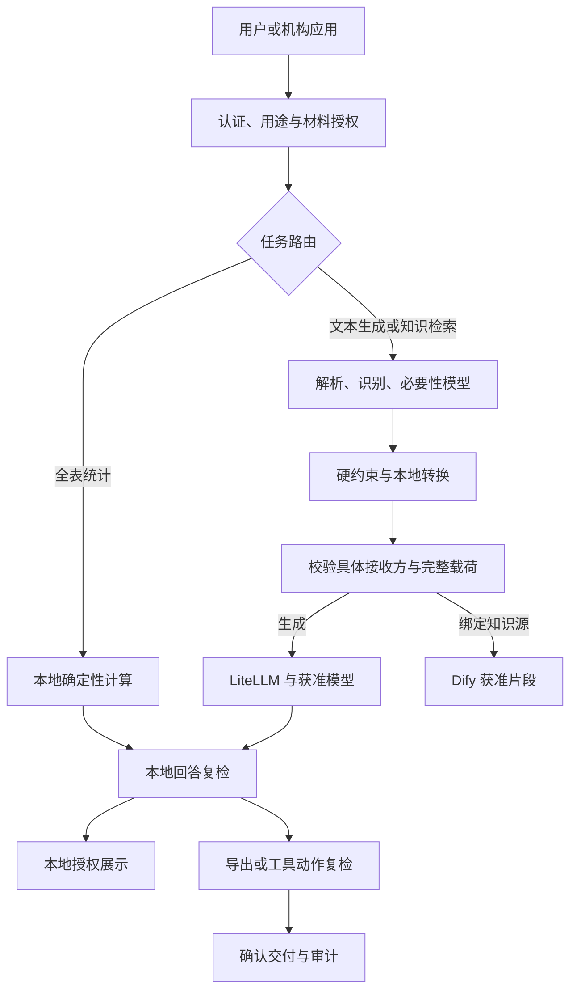

# 隐盾下一代系统设计与实施方案

实现方向已调整为在隐盾内开发对应功能。当前范围和各模块状态见[原生能力开发范围](../../current/原生能力开发范围.md)。本文的第三方服务部署步骤保留为前期方案记录，后续按原生能力逐项实施。

设计基线为 2.0 候选版主分支 85fca99。下文的阶段与验收指标用于下一代开发。已有功能和实测范围见[当前版本报告](隐盾2.0融合版系统架构与现状.md)。

## 1. 产品目标与代表任务

面向需要处理真实名单、记录和通知的高校部门。把竞争目标定为可实测的三件事：在同等任务质量下减少向外部披露的字段，在相同授权条件下减少误暂停，在材料或权限变化后阻止旧结果继续交付。

用同一份含姓名、专业、职责和联系方式的合成名单贯穿验收。问人数时在本地按专业字段计算，外部调用数应为零。起草纪要时保留职责和代号关系，拒绝发送电话。负责人查看获准版本时可在本机恢复姓名，导出给供应商时再按供应商权限生成版本。撤销材料授权后，先前的知识引用和工具预览必须失效。这组任务同时覆盖可用性、隐私和权限变化。

## 2. 部署与数据流

以现有 FastAPI 模块化应用承载身份、材料、策略、映射和任务执行。单机安装使用现有本地存储。机构部署阶段增加组织身份服务、关系数据库与受控文件存储。GPU 推理仅在并发或显存实测需要时独立为本地工作进程。LiteLLM 和 Dify 可以独立部署，Lakera 是需要单独授权的外部接收方。

本机保存原件和代号映射。每次跨边界操作重新取得组织、身份、用途、来源版本、策略版本、接收方与实际载荷。在调用前检查材料是否仍然有效。日志只记录主体标识、策略版本、动作、结果、耗时与事件编号。外部调用超时且可能已产生副作用时保留待核对事件，由幂等键对账。

## 3. 五项融合如何实现

| 组件 | 当前起点 | 下一代实现与验收 |
| --- | --- | --- |
| Presidio | 本地模式识别器生成统一 Span | 为识别器建立版本、类别、适用语言、优先级和正反例清单。注册到现有检测管线，按坐标和类别合并。GLiNER 继续负责五类语义，避免在 Presidio 内再次加载同一模型。以冻结样本比较每个识别器新增命中、误报与耗时，再决定默认组合。 |
| NeMo Guardrails | 本地 Colang 短语规则 | 将输入、检索、输出和工具检查分别配置为可测试流程。流程调用隐盾已有授权与复检动作，策略只能追加限制。策略包上线前回放历史合成案例，记录前后决策差异。无有效结果时暂停相应外发。 |
| LiteLLM | 已跑通真实代理到合成上游 | 使用组织项目凭证、模型别名、预算和限流。将路由绑定获准供应商和数据接收范围。同范围内才允许回退，测试供应商故障、预算耗尽和超时。记录实际路由和费用，禁记正文。 |
| Dify | 已实现外部知识接口和词项检索 | 接入真实 Dify 实例，固定知识源的组织、材料与用途。先按权限过滤来源，再对本地转换内容做词项检索与可选的本地向量检索。索引键包含组织、材料版本、用途和策略版本。撤销时立即禁止读取并异步清除旧索引。比较中文查询命中、引用正确性和越权返回数。 |
| Lakera | 已有受检文本接口契约 | 按接收方明确授权检查类型和可发送字段。在本地通过后，仅发送本次拟交付的片段。分别验证输入、输出、工具参数与工具响应的策略，故障时按该边界暂停，恢复后的本地展示始终留在本机。真实租户使用合成材料联调。 |

上游能力依据见 [Presidio](https://presidio.dataprivacystack.org/)、[NeMo](https://docs.nvidia.com/nemo/guardrails/about-nemo-guardrails-library/overview)、[LiteLLM](https://docs.litellm.ai/docs/)、[Dify](https://docs.dify.ai/en/cloud/use-dify/knowledge/readme) 和 [Lakera](https://docs.lakera.ai/docs/data-leakage-prevention)。具体版本、服务许可、账户策略和费用在部署时锁定。

## 4. 核心工程改造

1. **统一授权上下文。** 从登录会话派生主体和组织，服务端根据操作解析用途与接收方。材料、会话、知识源、映射与交付记录均带组织归属。数据库查询同时约束组织和对象标识。以跨组织同名材料、过期授权、撤权后的旧链接做负例。
2. **复用识别与动作决策。** 以现有 processing.analyze 为文本分析入口，保留原文坐标、识别器版本与类别。必要性模型继续逐段选择六个动作，硬约束决定放行或暂停。对有争议片段提供管理员复核，修订绑定来源及策略版本，每次修改重跑硬约束，避免将人工修订当作无限授权。
3. **把出口判断与实际发送绑定。** 在现有 EgressGateway 上增加一次操作的摘要与短期确认，绑定接收方、文档版本、策略版本和最终载荷。发送前重新验证并使用同一载荷。工具事件复用已有幂等记录。授权展示和外发分别渲染，缓存也分开。
4. **多进程与持久化。** 先保留单机内存会话。机构版以事务保存策略版本、材料状态和操作事件，撤销与操作预留使用一致的版本检查。若需跨进程恢复代号，单独设计组织密钥、加密、期限与删除流程，再迁移内存映射。数据库迁移用合成材料排练并保留上一版只读快照。
5. **可观察与复核。** 为解析、识别、决策、复检、生成分别计时，区分冷启动与稳定态。将误暂停按类别、任务、边界归因。管理员能从事件找到规则版本和被拦截原因，普通日志与指标中不出现原件、映射和密钥。

## 5. 精简与交付

| 内容 | 处理方式 | 如何判定可以下线 |
| --- | --- | --- |
| 在线与离线 Presidio 依赖 | 识别安装只声明 Analyzer；替换算子对照另装评测依赖 | 检查正常识别路径及离线比较脚本分别可运行 |
| 新旧架构和计划入口 | 当前实现、下一代方案和历史快照分别标明，保留旧引用 | 文档导航能直接定位当前版本和下一代方案 |
| 训练数据、多代权重、申报资料 | 按运行包、研究包、展示资料分别生成发布清单；保留研究源文件 | 空目录安装运行包，执行预检、表格与对话冒烟，再复现研究包里的基准 |
| 重复规则与可选组件 | 对各条规则和组件做消融，记录独有召回、误拦和时延；同语义规则只保留一个所有者 | 删除前对同一基准和各边界回放，核对变化并保留可回滚版本 |
| 校园项目协作 | 保留为独立业务入口，复用权限、材料和交付服务 | 关闭该入口后，文档处理与全表统计仍能运行 |

## 6. 分阶段实施与发布约束

| 阶段 | 交付物 | 进入下一阶段的条件 |
| --- | --- | --- |
| 一，建立基线 | 固定依赖、运行包、合成测试材料、现有版本报告与组件开关 | 新机器能启动；完整记录已有 GLiNER 误暂停及回归结果 |
| 二，本机策略整合 | 识别器注册、统一决策证据、分边界 NeMo 策略、管理员复核 | 同一份材料能完成三种任务；拒绝未授权恢复；硬约束不能被修改动作绕开 |
| 三，知识与模型接入 | 真实 Dify、获准 LiteLLM 正式上游、经授权的 Lakera 账户 | 合成样例验证正常、超时、拒绝、撤销和重试；核对外部服务实际收到的内容 |
| 四，机构试点 | 统一登录、组织隔离、版本化策略、预算、事件对账、审计导出 | 两个组织交叉访问测试全部拒绝；凭证撤销生效；异常重试不导致重复交付 |
| 五，独立对照与发布 | 冻结测试集、外部试用记录、安装升级与回滚演练、公开结果 | 在相同材料与权限下报告泄露率、误暂停率、必要事实保留率、任务完成率、P95 时延及每任务成本 |

对照实验至少包括仅规则、规则加 GLiNER、完整隐盾和按官方方式配置的对应组件。按文档来源划分训练与测试，使用未参与调参的人员独立复核，报告样本数与分母。建议发布门槛为冻结负例中观察到的跨组织披露为零、确定性统计与人工核对一致、所有选定外部接入均通过真实链路验收。效果和时延阈值应根据试点基线预先确定。只有取得同任务、同权限和同资源条件下的对照结果，才能对外报告具体领先维度。
