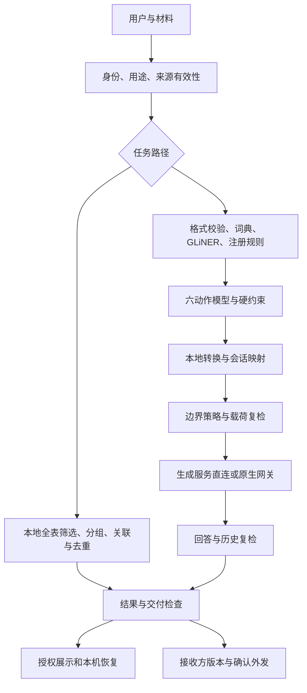

# 系统架构

FastAPI与原生网页承载本地工作台。原始材料在受控侧读取，外部服务生成通过检查的任务文字。

核心位于app/llm_shield，共用processing.analyze与EgressGateway。知识接口绑定材料、用途和接收方，转换后执行词项检索与片段复检。原生网关按管理员声明的接收范围限制回退。项目工作流支持分配核验、供应商核销与封存验收。条件见[当前状态](状态.md)。
