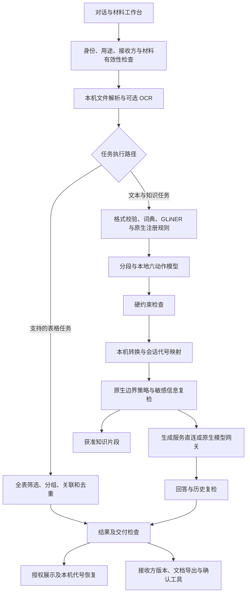

# 隐盾隐私保护对话与材料处理系统项目报告

报告日期为 2026 年 11 月 18 日。代码基线为主分支 `e9e16b8`，包含 PR #7 的原生识别与策略实现，以及 PR #8 的原生模型网关。报告结合当前代码、本机配置和最近一轮验证记录编写。

## 1. 项目定位与目标

隐盾面向高校活动管理、学生组织及小组协作中的名单统计、通知起草、会议整理和材料交付。系统先在本机理解材料结构、识别敏感字段并检查用途与权限，再决定哪些工作由本机执行、哪些必要内容可以交给生成模型，以及结果可以展示或交付给谁。

项目同时追求任务完成质量、披露控制和操作可复核性。典型目标包括按完整表格准确统计人数，在纪要中保留负责人与事项的关系，通过代号减少姓名披露，以及向不同接收方交付各自获准的版本。实际处理依据包括使用者身份、用户任务、材料用途、接收方、材料版本和有效期。

当前开发方向是将主流产品中适用的能力开发为隐盾自己的规则、策略、模型网关、知识检索和交付功能。Presidio、NeMo Guardrails、LiteLLM、Dify 与 Lakera 提供了能力范围的参考，现有原生实现按隐盾自身入口验收。

## 2. 当前系统架构

系统以 FastAPI 和原生网页承载应用，默认监听本机地址。核心文本分析复用 `processing.analyze`，出口权限与敏感内容检查复用 `EgressGateway`。模型输入、页面展示和工具外发具有各自的载荷和接收权限。原生策略进一步区分模型输入、模型回答、知识检索、授权展示、工具提交与工具响应六个位置。

表格任务按支持的口径对完整记录进行确定性计算。文本任务由识别器提供实体与位置，动作模型逐段选择处理方式。通过约束后，系统在本机转换内容，再复检实际准备发送或展示的结果。权限不足、材料失效或处理异常时暂停对应操作。

## 3. 功能现状

| 功能 | 已实现的行为 | 当前使用条件 |
| --- | --- | --- |
| 文件对话 | 上传材料、生成回答、沿用经过检查的会话历史追问 | 生成服务需要有效配置，回答仍接受复检 |
| 全表统计 | 支持字段筛选、组合条件、分组、关联与去重，回显统计口径 | 自然语言追问覆盖已支持的操作范围 |
| 结果导出 | 表格结果可导出 CSV、Excel，获准文档版本可重新排版导出 Word | 分享和下载沿用对应接收方检查 |
| 扫描材料 | 可选本机 OCR，按页形成可核对草稿 | 需要安装 OCR 依赖并人工核对识别结果 |
| 名单与通知 | 本机核对名单，使用获准的公开事项起草通知 | 通知路径使用独立约束 |
| 原生实体规则 | 配置识别器名称、类别、正则、分数和版本，检查重复规则 | 本机已启用，仍与格式校验、词典和 GLiNER 协同 |
| 六动作处理 | 删除、本地汇总、泛化、假名化、保留、暂停 | 使用默认动作权重，硬约束只能放行首选或暂停 |
| 代号与授权恢复 | 会话内复用代号，在本机按查看权限恢复 | 映射存于会话内存，跨会话隔离 |
| 原生边界策略 | 公共短语、各边界短语、分边界正则检查 | 本机已启用，支持六个检查位置 |
| 原生知识检索 | 绑定材料、用途、身份和接收方，转换后词项检索，返回片段与引用 | API 已实现，本机当前没有配置知识源绑定 |
| 原生模型网关 | 多目标路由、同范围回退、预算预留、限流、用量记录和管理员查询 | 代码与测试已完成，本机当前仍采用 DeepSeek 直连 |
| 确认工具 | 固定目的地预览、人工确认、配置与内容绑定、事件幂等和响应复检 | API 已实现，本机当前没有配置工具绑定 |
| 项目协作 | 资源分配与核验、供应商凭证、签到核销及封存验收 | 适用于现有本机管理员流程 |

## 4. 模型与原生组件

GLiNER v3 负责补充人名、机构、地点、宿舍和敏感属性五类语义信息。格式类识别由规则及适用的校验位检查执行，原生注册规则用于扩展领域模式。默认动作分类器为 `structured_content_v3`，采用 TF-IDF、结构特征与逻辑回归。生成模型负责根据获准内容生成文字，隐私动作由本地流程决定。

本机已启用 GLiNER，自动选择 CUDA。本机配置还启用了原生注册规则和边界策略。Campus NER 已退出默认在线流程，历史复核 BERT 保留为离线研究代码。活动权重及哈希见[模型清单](../../app/models/ACTIVE_MODELS.json)。现有权重的训练来源应结合相应研究记录审核。

原生注册规则与策略检查已使用隐盾自己的代码执行。旧版配置键提供迁移兼容，运行时执行来源标识已更新。原生知识检索地址为 `POST /api/knowledge/retrieval`，兼容地址调用同一套本地实现。

原生模型网关通过 `LLM_PROVIDER=shield` 选择。它将配置中的模型目标组成有序路由，校验管理员声明的接收范围，并在每次尝试前用 SQLite 事务预留预算与计入请求额度。429、5xx 或连接异常可在获准范围内回退，缺少用量回执和超时的请求保留预留费用。有效 token 回执按配置价格更新费用，管理员可查看当月记录。

预算基于输入估算、输出上限和管理员配置价格实施准入。供应商实际用量可能超过预留，账本据回执更新后限制后续请求，实际费用需要与供应商账单核对。当前网关采用本机共享账本，机构分账与虚拟密钥仍在后续范围内。

## 5. 系统创新与实际价值

**任务与接收方共同决定信息处理。** 同一份名单用于统计、通知或纪要时，分别保留完成任务所需的数字、公开事项或人物关系。六动作模型与硬约束将这些选择接入实际工作流。

**完整数据计算与文本生成各有执行路径。** 已支持的表格问题在本机根据完整记录计算，保留口径和来源。文本检索按片段提供获准事实，两条路径可以分别验证结果正确性和披露范围。

**授权恢复与结果交付分开校验。** 用户查看时可能获准恢复姓名，面向外部接收方的版本仍需按其权限检查。会话映射、导出版本和确认工具共同支持这一过程。

**把披露约束延伸到知识与模型运营。** 知识源绑定用途和材料版本，生成路由绑定管理员声明的接收范围，费用记录保留尝试状态。项目可以同时核对任务输出、外发目的地和调用成本。

上述内容属于当前项目的系统设计和应用贡献。可对外报告的具体效果，应以相同任务、相同授权和独立样本上的对照结果为依据。

## 6. 版本与验证记录

| 项目 | 证据与范围 |
| --- | --- |
| 主分支 | `e9e16b8`，已包含 PR #7 和 PR #8 |
| 原生模型网关定向验证 | 32 项通过，含实际回环 HTTP、并发预算、超时预算保留、限流、范围校验、费用 API 与连接诊断 |
| 最近一次默认配置回归 | 497 项通过，33 项子检查通过，另有 1 项旧多轮用例因 GLiNER 误报而暂停 |
| 原生规则验证 | 测试阻止第三方护栏库导入和网络请求，检查本机识别与规则拒绝 |
| 运行包 | 最新轻量运行包约 1 MB，带动作权重、配置、网页、合成材料与逐文件哈希。GLiNER 完整目录需要单独配置 |
| 本报告核对 | 已核对主分支、默认模型清单及活动配置，并重新执行启动预检，动作模型与 regex、entity、GLiNER、registered_rules 就绪，GLiNER 使用 CUDA |

本轮网关测试使用合成上游，未发起付费模型调用。历史识别 F1、必要性裁定匹配数和端到端任务成功率具有不同分母，应分别引用。报告中的测试通过数体现工程验证范围。

## 7. 当前成熟度与待完成工作

项目已具备本机可运行候选版及受控试点的工程基础。对话、全表运算、文档交付、原生识别、策略检查和网关已有实现与测试。原生网关仍需按实际供应商配置价格、预算和获准目标后开展部署验收。

| 后续工作 | 当前缺口 |
| --- | --- |
| 知识库完善 | 混合检索、索引管理、知识库界面与检索效果对照 |
| 规则与流程管理 | 更完整的策略回放、逐实体管理员复核、可视化任务编排 |
| 模型运营 | 机构虚拟密钥、组织与用户分账、账单核对、路由配置界面 |
| 通用风险检测 | 更广的注入检测、风险归因与独立对抗评测 |
| 组织部署 | 统一登录、组织隔离、对象级授权、持久化与迁移验收 |
| 文档和现场操作 | 原版式脱敏、手机扫码、离线补传 |
| 质量改进 | GLiNER 误报分析，按任务测量误暂停、必要事实保留、时延和成本 |

已知 GLiNER 偶发误报会造成正常任务暂停，最近一次回归再次出现该问题。运行包曾在空目录中复用本机环境和权重验证，新机器从零安装仍需单独验收。项目仍以 2.0 候选版管理。

## 8. 资料入口

- [原生能力开发范围](../current/原生能力开发范围.md)
- [原生模型网关配置与账务说明](../current/原生模型网关.md)
- [下一代实施进度](../archive/technical/下一代实施进度.md)
- [模型版本与权重说明](../../app/models/README.md)
- [安装与验证](../current/从GitHub安装与验证.md)
